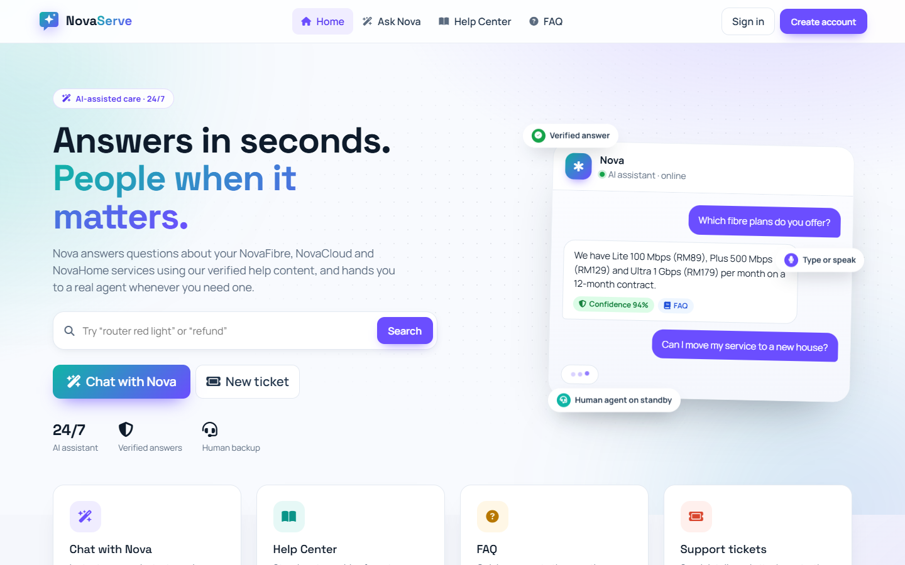
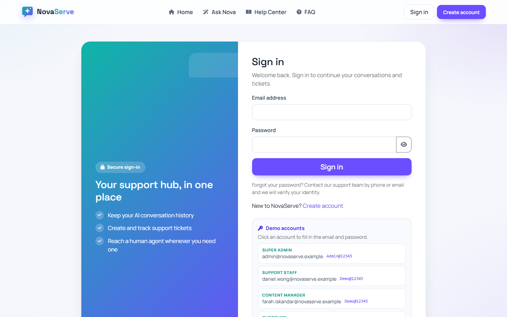
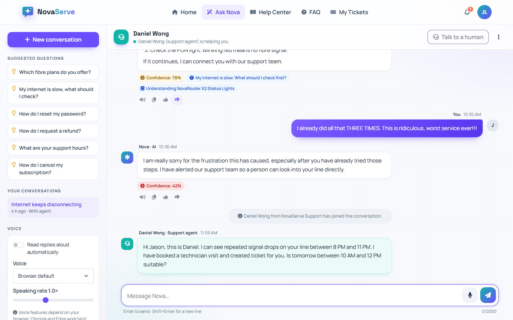
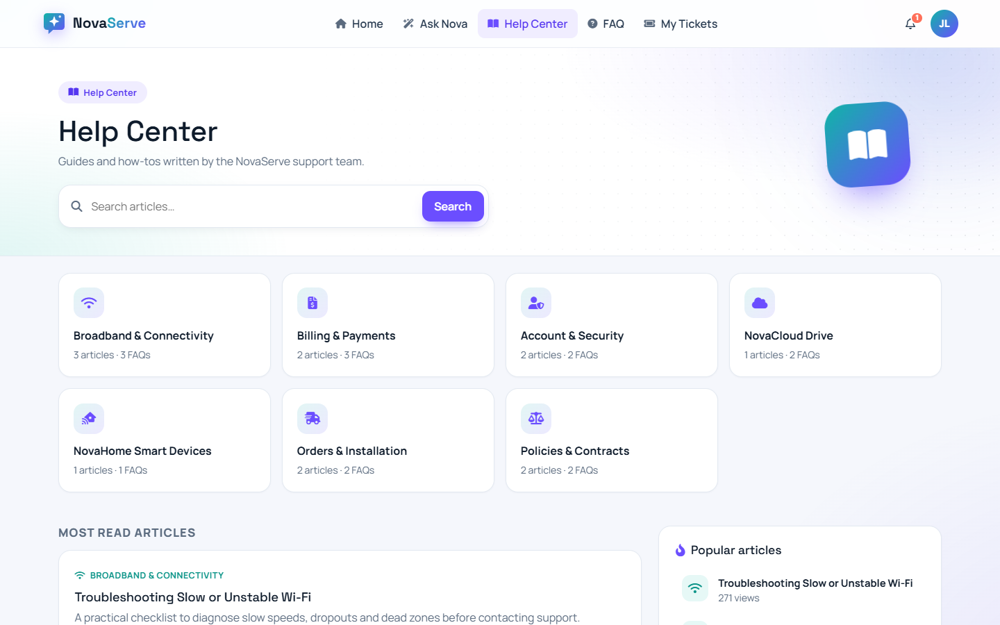
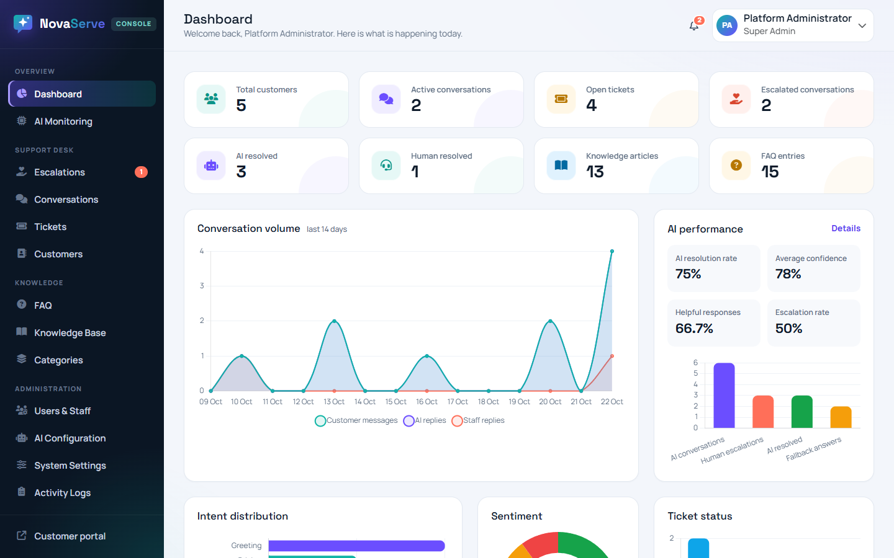
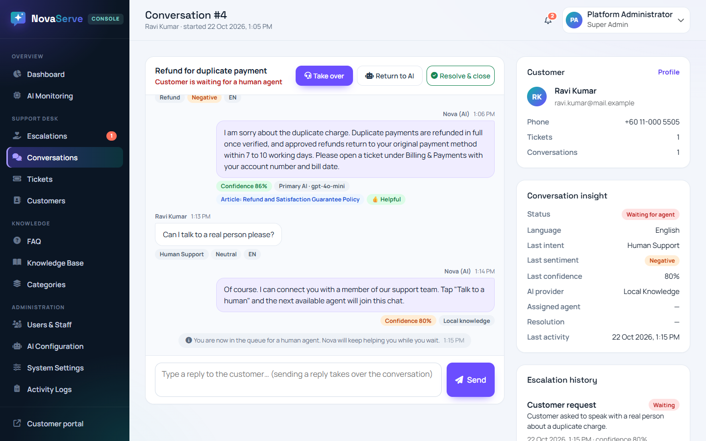

# NovaServe Intelligent Customer Support Platform

An AI-powered customer service and support web application for **NovaServe Technologies** — a fictional Malaysian provider of fibre broadband (NovaFibre), cloud storage (NovaCloud Drive) and smart-home devices (NovaHome).

Customers chat with **Nova**, an AI assistant that answers from a verified knowledge base, shows its confidence, supports voice input/output, and hands the conversation to a human agent when needed. Staff manage tickets, escalations, FAQ and articles from a role-based console with analytics.

Built with **PHP 8+**, **MySQL / MariaDB**, **PDO**, **Bootstrap 5**, **Chart.js** and **Vanilla JavaScript**. Designed for **XAMPP** and **cPanel shared hosting**. No frameworks, no Node.js, no Composer.

**Live demo:** [https://weihern.kolejsynergy.com/Ai_Customer_Service/](https://weihern.kolejsynergy.com/Ai_Customer_Service/)

> All company details, people, prices, policies and sample content in this project are fictional.

---

## Screenshots

### 1. Customer Portal


### 2. Sign In (with demo accounts)


### 3. AI Chat with Human Takeover


### 4. Help Center (Knowledge Base)


### 5. Admin Dashboard & Analytics


### 6. Live Conversation & Escalation Console


---

## 1. Features

**Customer portal**
- Homepage with live knowledge search, service highlights, contact details and business hours
- AI chat: typing indicator, timestamps, suggested questions, conversation history, “clear & start new”, source links, confidence badges, 👍/👎 feedback with optional comment
- Voice input (SpeechRecognition) and spoken replies (SpeechSynthesis) with voice and speed selection
- “Talk to a human” escalation and live agent replies in the same chat window
- FAQ (search, category filter, popular questions, view counting) and Help Center (search, categories, related and popular articles)
- Support tickets with attachments, status progress tracker, replies and notifications
- Profile page (name, phone, language, password) with ticket and conversation statistics
- Interface in **English, Bahasa Melayu and 中文**

**AI engine** (`includes/ai/`)
- RAG pipeline: keyword extraction (with Malay/Chinese → English synonym mapping) → FAQ + article retrieval → context-grounded prompt
- Intent detection (14 intents) and sentiment detection (positive / neutral / negative / angry) that run locally, so they still work without any AI provider
- Confidence score per answer; answers below the configurable threshold recommend a human
- Fallback chain: **Primary AI → Fallback AI → Local knowledge base**. The chat never breaks if a provider is down
- Works with any OpenAI-compatible API (OpenAI, Google Gemini, Groq, OpenRouter, DeepSeek, Ollama…)
- Angry customers trigger staff notifications and (optionally) automatic escalation

**Staff console** (`admin/`)
- Dashboard with KPI cards and Chart.js charts (intents, sentiment, ticket status, AI performance, 14-day volume)
- Escalation queue, conversation monitor with live transcript, take over / return to AI / resolve
- Ticket management: status, priority, assignment, public replies, internal notes, attachments
- Customer directory and profiles
- FAQ (create, edit, delete, activate, reorder), knowledge articles (draft/publish), categories
- Users & staff management, AI configuration (encrypted API keys + connection test), system settings
- AI monitoring with date filter, activity/audit log with search and filters, notification bell

---

## 2. Technology stack

| Layer | Technology |
|---|---|
| Backend | PHP 8.1+ (8.3 recommended), PDO, prepared statements, sessions |
| Database | MySQL 8+ or MariaDB 10.4+ (InnoDB, utf8mb4) |
| Frontend | HTML5, CSS3, vanilla JavaScript, Bootstrap 5.3, Font Awesome 6, Google Fonts |
| Charts | Chart.js 4 |
| AI | Any OpenAI-compatible chat-completions REST API via cURL |

No Composer, Node.js or build step is required. Bootstrap, Font Awesome, Chart.js and the fonts are loaded from public CDNs, so the browser needs internet access.

---

## 3. Folder structure

```text
Ai_Customer_Service/
├── admin/                 Staff console pages (dashboard, tickets, conversations, content, settings…)
├── api/                   JSON endpoints (chat, messages, escalation, feedback, notifications, faq, knowledge, tickets)
├── assets/
│   ├── css/app.css        Visual identity + responsive layout
│   ├── js/                app.js (shared), chat.js, voice.js, staff-chat.js, admin.js
│   └── images/logo.svg
├── config/                config.sample.php (config.php is generated by the installer)
├── database/              schema.sql, sample_data.sql, database.sql (all-in-one), cpanel_import.sql (phpMyAdmin on cPanel)
├── docs/screenshots/      README screenshots
├── includes/
│   ├── ai/                TextAnalyzer, KnowledgeRetriever, PromptBuilder, AiEngine, providers, LocalResponder
│   ├── core/              Config, DB, Auth (RBAC), Session, Settings, Crypto, Lang, AuditLog, Notifier, FileUploader…
│   ├── services/          ChatService, EscalationService, TicketService, ContentService, Analytics
│   ├── layout/            Shared headers/footers and partials
│   ├── bootstrap.php      Loaded by every entry script
│   └── helpers.php        Escaping, CSRF, redirects, formatting
├── lang/                  en.php, ms.php, zh.php (interface translations)
├── storage/logs/          Server-side error/application logs
├── uploads/tickets/       Ticket attachments (blocked from direct web access)
├── index.php, chat.php, faq.php, knowledge.php, article.php, ticket.php, ticket_view.php,
├── profile.php, login.php, register.php, logout.php, download.php
└── install.php            Web installer (locks itself after use)
```

---

## 4. Installation on XAMPP (Windows)

1. Clone the repository into `C:\xampp\htdocs\`:
   ```bash
   cd C:\xampp\htdocs
   git clone https://github.com/weihern08/Ai_Customer_Service.git
   ```
2. Start **Apache** and **MySQL** in the XAMPP Control Panel.
3. Open `http://localhost/Ai_Customer_Service/` — you will be redirected to the installer.
4. Fill in the form:
   - Database host `127.0.0.1`, port `3306`, database `novaserve_support`
   - User `root` and your MySQL password (empty on a fresh XAMPP)
   - Your administrator name, email and password (10+ characters)
   - Keep “Import fictional sample data” ticked for a demo-ready system
5. Click **Install NovaServe**. The installer creates the database and tables, writes `config/config.php` with a new encryption key, and creates `storage/installed.lock`.
6. Sign in at `http://localhost/Ai_Customer_Service/login.php`.

### Manual database setup (alternative)

1. In phpMyAdmin, open the **Import** tab and import `database/database.sql`. This creates `novaserve_support` with all tables and sample data.
2. Copy `config/config.sample.php` to `config/config.php`, then set the database credentials and a 64-character hexadecimal `key` (`php -r "echo bin2hex(random_bytes(32));"`).
3. Create an empty file `storage/installed.lock`.
4. Sign in with the default administrator below and **change the password immediately**.

---

## 5. Default accounts

| Role | Email | Password |
|---|---|---|
| Super Admin (manual import only) | `admin@novaserve.example` | `Admin@12345` |
| Super Admin (web installer) | the email you entered | the password you entered |
| Support Staff | `daniel.wong@novaserve.example` | `Demo@12345` |
| Support Staff | `priya.nair@novaserve.example` | `Demo@12345` |
| Content Manager | `farah.iskandar@novaserve.example` | `Demo@12345` |
| Customer | `hafiz.kamarul@mail.example` (BM), `meiling.tan@mail.example` (中文), `jason.lim@mail.example`, `nurul.huda@mail.example`, `ravi.kumar@mail.example` | `Demo@12345` |

Sample accounts are created only when sample data is imported. Delete or suspend them before going live.

---

## 6. AI configuration

Go to **Console → AI Configuration** (Super Admin only).

1. **Primary provider**: enter the chat-completions URL, model name and API key, for example:

   | Provider | Endpoint URL | Example model |
   |---|---|---|
   | OpenAI | `https://api.openai.com/v1/chat/completions` | `gpt-4o-mini` |
   | Google Gemini | `https://generativelanguage.googleapis.com/v1beta/openai/chat/completions` | `gemini-2.0-flash` |
   | Groq | `https://api.groq.com/openai/v1/chat/completions` | `llama-3.1-8b-instant` |
   | OpenRouter | `https://openrouter.ai/api/v1/chat/completions` | any listed model |
   | Ollama (local, no key) | `http://localhost:11434/v1/chat/completions` | `llama3.1` |

2. Optionally configure a **fallback provider** and tick “Use this provider when the primary provider fails”.
3. Click **Save configuration**, then **Test saved settings** for each provider.
4. Tune temperature, maximum tokens, timeout, conversation memory, the **confidence threshold** and **automatic escalation of angry customers**.
5. Edit the **system prompt** to change Nova’s personality. Safety rules, verified company facts (from System Settings), retrieved knowledge and the reply language are always appended automatically.

**Without any API key** the assistant still works in *local knowledge mode*: it answers from the FAQ and articles, gives business hours and contact details from settings, and recommends human support when it cannot find verified information.

### How an answer is produced

```text
Customer message
   → language + intent + sentiment + keywords   (TextAnalyzer, local)
   → FAQ + article retrieval with relevance score (KnowledgeRetriever)
   → prompt = persona + rules + verified facts + retrieved context (PromptBuilder)
   → Primary AI → (fails) Fallback AI → (fails) Local knowledge responder
   → confidence score → "talk to a human" recommendation if below threshold / angry / requested
```

The AI is instructed to append a hidden marker when the verified context does not contain the answer; the marker is removed and the confidence is lowered automatically. Every provider attempt (success, failure, latency) is logged in `ai_request_logs` and shown on **AI Monitoring**.

---

## 7. Deploying to cPanel shared hosting

1. In **MySQL Databases**, create a database and a user, then add the user to the database with *All privileges*.
2. Upload the project (zip + extract in File Manager) to `public_html/` or a sub-folder such as `public_html/support/`.
3. Make sure `config/`, `storage/` and `uploads/tickets/` are writable (permissions 755; files 644).
4. Select **PHP 8.1+** (8.3 recommended) in *Select PHP Version* / *MultiPHP Manager* and enable `pdo_mysql`, `mbstring`, `openssl`, `curl` and `fileinfo`.
5. Either visit `https://your-domain/support/install.php` and enter the cPanel database name and user (usually prefixed, for example `cpuser_novaserve`), **or** import `database/cpanel_import.sql` in phpMyAdmin (it has no `CREATE DATABASE`/`USE` lines, so it imports into the selected database), then create `config/config.php` from `config/config.sample.php` with `'host' => 'localhost'` and an empty `storage/installed.lock`.
6. Recommended: enable HTTPS (AutoSSL). Optionally set `upload_path` in `config/config.php` to a folder outside `public_html` for attachments.

---

## 8. Security notes

- Passwords hashed with `password_hash()` / `password_verify()`; automatic re-hashing
- All SQL uses PDO prepared statements; identifiers are validated
- All output escaped with `htmlspecialchars()` (`e()` helper); chat text rendered with a safe escape-first formatter
- CSRF tokens on every state-changing form and API call (form field or `X-CSRF-Token` header)
- Hardened sessions: HttpOnly, SameSite=Lax, Secure on HTTPS, strict mode, ID regeneration at login, idle timeout (configurable)
- Login throttling: 5 failed attempts per IP in 15 minutes, then a lockout
- Role-based access control is enforced on every page and endpoint (`Auth::requirePermission()`), not only by hiding menus
- Customers can only see their own conversations, tickets, attachments and feedback; internal notes are never sent to customers
- Uploads: extension whitelist, MIME sniffing, size limit, script detection, random stored names, `.htaccess` deny + no script execution, downloads only through `download.php` after an access check
- AI API keys encrypted at rest (AES-256-GCM, key in `config/config.php`), never sent to the browser, never included in prompts
- `config/`, `includes/`, `database/`, `storage/` and `lang/` are blocked over HTTP; security headers set in `.htaccess` and PHP
- Raw PHP errors are hidden from visitors; details are written to `storage/logs/`
- The installer locks itself with `storage/installed.lock`

---

## 9. Browser voice support

| Feature | Chrome / Edge | Safari | Firefox |
|---|---|---|---|
| Voice input (SpeechRecognition) | ✅ | ✅ (macOS/iOS 14.5+) | ❌ |
| Spoken replies (SpeechSynthesis) | ✅ | ✅ | ✅ |

- Voice input needs microphone permission and, except on `localhost`, an **HTTPS** site.
- Chrome sends audio to Google’s speech service for recognition, so it needs internet access.
- Available voices depend on the operating system. Malay (`ms-MY`) voices are not installed on every device; the browser falls back to its default voice.
- If a feature is unsupported, the microphone button is dimmed and an explanation is shown.

---

## 10. Multi-language

- **Default: English only.** The whole site, emails/notifications and the AI assistant's replies are in English, and the language switcher is hidden.
- To turn on English / Bahasa Melayu / 中文, enable **Console → System Settings → Multi-language mode**. The globe-icon switcher then appears and Nova replies in the customer's language.
- Interface strings live in `lang/en.php`, `lang/ms.php` and `lang/zh.php` (same keys; missing keys fall back to English). JavaScript strings are the `js.*` keys, passed to the browser by PHP.
- The language selector (globe icon) stores the choice in the session and in the user’s profile.
- Nova detects the language of each message (Chinese characters, Malay/English marker words) and replies in that language. Knowledge content is written in English; the AI translates it, while local mode shows the English content with a localised introduction.
- To add a language, copy `lang/en.php`, translate the values, and register it in `Lang::AVAILABLE` (`includes/core/Lang.php`).

---

## 11. Troubleshooting

| Problem | Solution |
|---|---|
| Redirected to `install.php` | `config/config.php` or `storage/installed.lock` is missing. Run the installer or follow the manual setup. |
| “Our service is temporarily unavailable” | Database connection failed: check MySQL is running and the credentials in `config/config.php`. Details are in `storage/logs/`. |
| Installer says “Access denied for user” | Wrong MySQL user/password. On XAMPP check phpMyAdmin’s `config.inc.php` or reset the root password. |
| Want to reinstall | Delete `storage/installed.lock` (and optionally `config/config.php`), then open `install.php` and tick “Replace existing tables”. |
| AI always answers from local knowledge | No API key, AI disabled, or the provider fails. Use **Test saved settings** and check **AI Monitoring → Recent provider failures**. |
| AI test fails with SSL errors on XAMPP | Update `curl.cainfo` in `php.ini` to point to a current `cacert.pem` bundle, then restart Apache. |
| Uploads fail | Check `uploads/tickets/` is writable and PHP `upload_max_filesize` / `post_max_size` are at least the configured limit. |
| “Your security token has expired” | The form was open too long or cookies are blocked. Refresh the page and submit again. |
| Locked out after failed logins | Wait 15 minutes (the lockout is per IP address). |
| Styles or icons missing | The CDN files could not load. Check the internet connection. |
| Microphone button does nothing | Use Chrome/Edge, allow microphone access, and use HTTPS when not on localhost. |

---

## 12. Known limitations

- **Password reset by email is not automated**, because shared hosting and XAMPP rarely have a configured mail server. Customers contact support, and an administrator sets a temporary password in **Users & Staff**.
- **Live chat uses polling** (every 4 s while the page is visible) instead of WebSockets, which are not available on standard shared hosting.
- **Intent and sentiment detection are rule- and lexicon-based** for speed, cost and offline reliability. They are tuned for customer-service vocabulary in English, Malay and Chinese and can be extended in `TextAnalyzer.php`.
- **Knowledge content is single-language (English).** The AI translates answers; local mode shows English content with a localised introduction.
- **Voice features depend on the browser** (see section 9).

## 13. Testing checklist (performed)

The project was verified end-to-end on XAMPP (PHP 8.2, MariaDB 10.4), including: installer and lock; registration, login, logout, wrong password, login throttling and session handling; RBAC for every role on every console page; AI chat in English, Malay and Chinese; intent and sentiment detection; low-confidence and angry-customer escalation; human takeover with live replies; primary-AI failure → fallback AI → local knowledge (using a mock OpenAI-compatible server); API key encryption; tickets, replies, internal notes, assignment and status changes; attachment upload/download and rejection of disguised PHP files; FAQ/article management; notifications; audit logs; SQL-injection and XSS probes; CSRF rejection; direct-URL access to protected folders; responsive layouts.

---

## License

This project is licensed under the [MIT License](LICENSE).
